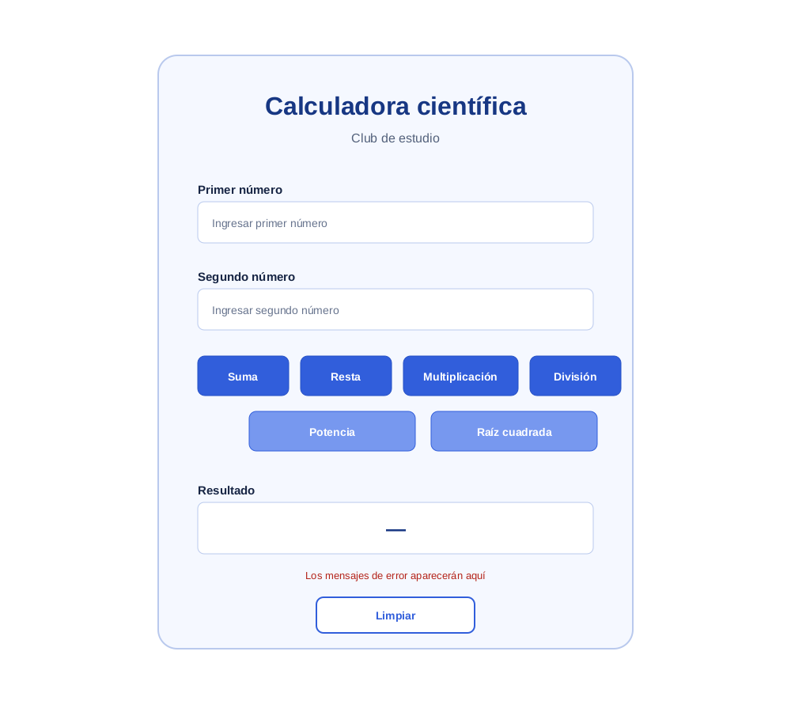
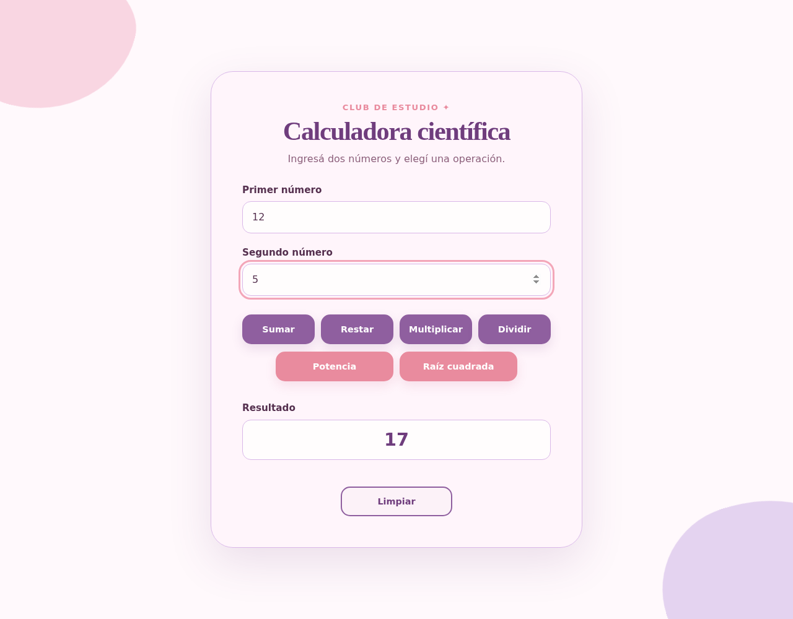
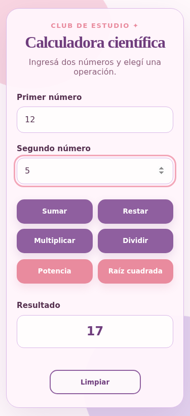

# Calculadora científica

## 🧩 Datos generales

| Campo | Detalle |
| --- | --- |
| Integrante 1 | Avishag Sadrinas |
| Integrante 2 | No corresponde: trabajo individual |
| Modelos de IA utilizados | GPT-5.6 Sol y GPT-6 Luna |
| Tecnologías del proyecto | HTML, CSS, JavaScript, editor de diagramas, Notion y GitHub |
| Link del repositorio | [calculadora-cientifica](https://github.com/avishagsad/calculadora-cientifica) |

---

## 📄 Sketch

**Archivo editable:** [sketch-calculadora.drawio](evidencias/sketch-calculadora.drawio)

**Captura de pantalla:**



El sketch fue creado y registrado antes del primer prompt de código.

---

## 💬 Prompts utilizados

**Prompt 1:**

```txt
Actuá como desarrollador web. Implementá la primera versión de una calculadora científica para un club de estudio siguiendo el sketch registrado. Creá index.html, style.css y script.js sin frameworks ni dependencias externas. La interfaz debe tener dos campos numéricos con IDs numero-a y numero-b, un área de resultado con ID resultado, un área de errores con ID mensaje-error y botones para sumar, restar, multiplicar, dividir y limpiar. En esta primera versión implementá solamente las cuatro operaciones básicas y el botón limpiar; los botones de potencia y raíz cuadrada deben estar visibles pero deshabilitados para incorporarlos en la siguiente versión. Usá HTML semántico, etiquetas asociadas a los campos, resultado y error accesibles, fondo claro, colores azules y diseño adaptable a móvil. La división por cero y los campos vacíos deben mostrar mensajes claros.
```

**Prompt 2:**

```txt
Activá las funciones científicas del sketch. Potencia debe calcular el primer número elevado al segundo. Raíz cuadrada debe usar solamente el primer número y no exigir el segundo campo. Validá la raíz de números negativos y cualquier resultado no finito con mensajes claros. Conservá las cuatro operaciones básicas, limpiar, accesibilidad, diseño adaptable y la estética femenina y artsy de la versión actual.
```

**Prompt 3 — corrección:**

```txt
Al completar los dos campos y presionar Enter, la calculadora no realiza ninguna operación y el resultado permanece en “—”. Corregilo para que Enter desde cualquiera de los campos ejecute la suma, sin recargar la página y conservando el comportamiento de los demás botones.
```

**Error observado:** con 4 y 2 cargados, Enter dejaba el resultado en “—”.

**Resultado mejorado:** después de la corrección, Enter devuelve 6 sin recargar la página.

La pre-entrega requiere al menos tres prompts iterativos y un ejemplo real de error → prompt de corrección → resultado mejorado.

---

## 🔄 Diferencias entre versiones

| Versión | Cambios | Razón |
| --- | --- | --- |
| v1 | Interfaz y cuatro operaciones básicas; potencia y raíz visibles pero deshabilitadas. | Primera versión basada en el sketch. |
| v2 | Paleta lavanda, rosa y coral; formas orgánicas, bordes suaves y título editorial. | Darle al proyecto una identidad más femenina y artística. |
| v3 | Potencia, raíz cuadrada y validaciones para raíces negativas y resultados no finitos. | Completar las funciones científicas exigidas por la pre-entrega. |
| v4 | Enter desde los campos ejecuta la suma sin recargar la página. | Corregir el error de teclado observado durante las pruebas. |

---

## Estado del proyecto

- [x] Sketch
- [x] Prompts registrados
- [x] Proyecto funcionando
- [x] Guardado en GitHub

---

## Planeamiento

Tema: herramienta del club de estudio. Módulo 3.

Dos campos: Primer número y Segundo número. Botones: suma, resta, multiplicación, división, potencia, raíz cuadrada y limpiar. Potencia utiliza ambos campos; raíz solamente el primero. Resultado y errores accesibles dentro de la página.

Identificadores: numero-a, numero-b, resultado, mensaje-error. Archivos: index.html, style.css, script.js. Paleta lavanda, rosa y coral, detalles orgánicos y distribución adaptable a móvil.

## Pruebas previstas

2 + 3 = 5; 2 − 5 = −3; −4 × 2 = −8; 7 ÷ 2 = 3.5; 2 elevado a 3 = 8; raíz de 9 = 3.

Validar vacíos, entradas inválidas, división por cero, raíz negativa y resultados no finitos. Probar decimales, limpiar, teclado y móvil.

## Pruebas realizadas

Se verificaron en Chrome:

- 2 + 3 = 5
- 2 − 5 = −3
- −4 × 2 = −8
- 7 ÷ 2 = 3.5
- 2 elevado a 3 = 8
- raíz de 9 = 3 sin completar el segundo campo
- división por cero
- raíz de número negativo
- campos obligatorios vacíos
- resultado no finito
- botón Limpiar
- suma con Enter desde los campos
- navegación por teclado
- ausencia de errores de página
- ausencia de desbordamiento a 320, 375, 768 y 1280 píxeles

### Capturas de funcionamiento





## Evidencias y requisitos de la pre-entrega 3

- [x] Cuatro operaciones básicas comprobadas
- [x] Dos funciones científicas comprobadas
- [x] Fidelidad al sketch
- [x] Al menos tres prompts iterativos registrados
- [x] Error → prompt de corrección → resultado mejorado documentado
- [x] Captura de la calculadora funcionando
- [x] README con todo el registro de Notion
- [x] Repositorio público actualizado
- [x] [PDF de la pre-entrega](evidencias/Preentrega2_Sadrinas_Avishag.pdf)

La estudiante realizará la presentación en Coderhouse.
